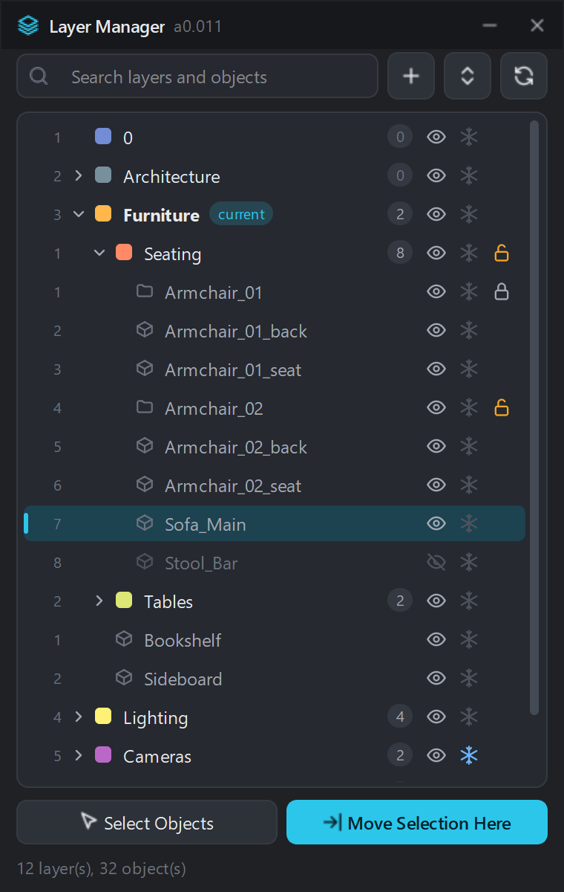
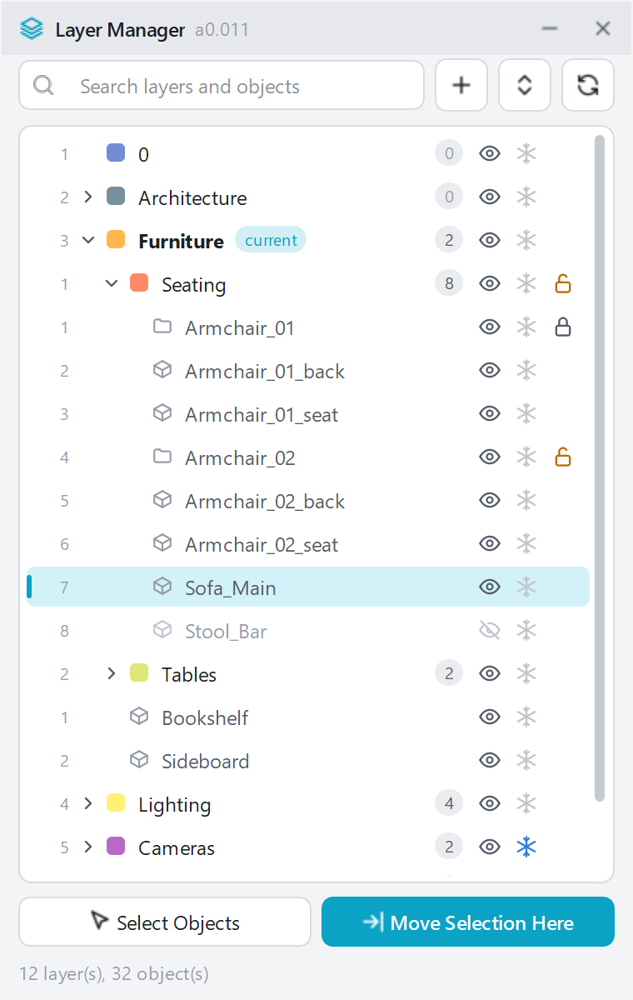

# Layer Manager for 3ds Max

A compact floating panel for Autodesk 3ds Max that keeps scene layers one click away:
nested layers and the objects inside them on one list, with hide, freeze, group and
colour controls on every row.

<p>
  
  
</p>

Website: https://shimodos.github.io/layer-manager-site/

## Features

- **Layer tree** with nested layers, colour swatches and object counts.
- **Objects inside each layer.** Click a row to select the object in the viewport,
  Ctrl+click to add it to the selection. Objects are tracked by handle, so renaming is safe.
- **Hide / freeze** toggles on every row, for a layer or a single object.
- **Group lock**: open or close one group, or every group of a layer at once.
- **Search** layers and objects by name.
- **Isolate** a layer (Alt+click the eye), **Show All** to bring the rest back.
- **Move Selection Here**, **Select Objects**, move one object to another layer from its menu.
- Create (also nested), rename, recolour and delete layers; set the current layer.
- **Live**: follows objects and layers created, deleted, renamed, hidden or frozen
  anywhere in 3ds Max, including the Scene Explorer.
- Every change is one named **undo** step.
- **Dark and light** palettes, picked from the 3ds Max colour scheme.
- Stays quick on heavy scenes: object rows are built only for the layers you open.
- Rolls up into its title bar and parks at the bottom of the 3ds Max window.

| Action | How |
| --- | --- |
| Select an object | click its row (Ctrl+click adds) |
| Rename a layer | double-click its name |
| Isolate a layer | Alt+click the eye |
| Open / close a layer | click the chevron |
| New child layer, set current, delete | right-click menu |

## Requirements

3ds Max with Python 3 and `qtmax`. Tested in **3ds Max 2024** (PySide2) and
**3ds Max 2026** (PySide6); the same file runs in both. Other versions are untested.

## Install

1. Download `LayerManager.mzp` from the [latest release](https://github.com/Shimodos/LayerManager/releases/latest).
2. Drag it onto a 3ds Max viewport (or *Scripting → Run Script*).
3. *Customize → Customize User Interface → Toolbars*, category **AD Tools**,
   drag **LayerMgr** onto a toolbar.

The installer copies `layer_manager.py` to `<user scripts>\python`, the toolbar icons to
`<user icons>`, removes older versions (`Test_009_01.py`, `Test_010_01.py`) and defines the
`LayerManager` macro. A button placed by an earlier version keeps working.

To try it without installing: *Scripting → Run Script* → `src/layer_manager.py`.

## Development

```
src/layer_manager.py      the whole tool, one file
installer/                install.ms, mzp.run and toolbar icons
tests/                    checks that run inside 3ds Max
tools/build_mzp.ps1       builds dist/LayerManager_<version>.mzp
tools/make_shots.ps1      renders docs/shots (screenshots and demo frames)
```

Tests drive the real panel inside 3ds Max through `3dsmaxbatch.exe` (no window is shown)
on every installed version:

```powershell
pwsh tests/run_tests.ps1            # all installed versions
pwsh tests/run_tests.ps1 -Years 2026
```

Screenshots are rendered the same way, from the panel itself rather than from the screen:

```powershell
pwsh tools/make_shots.ps1
```

A release is built by GitHub Actions when a `v*` tag is pushed.

## Notes on the 3ds Max API

Found while testing, in case they save someone an evening:

- 3ds Max has no callback for layer property changes (`#layerPropChanged` and
  `#layerRenamed` do not exist), so the panel compares a snapshot of the layer list on a timer.
- `layer.setName` ignores a rename that only changes letter case; the panel goes through a
  temporary name.
- A layer with nested layers cannot be deleted; they are re-parented first.
- A Python exception raised while a `QPainter` is active on a `QImage` takes the whole
  3ds Max process down, so painting is wrapped in `try / finally: painter.end()`.

## License

MIT. Icons in the panel are drawn in the style of [Lucide](https://lucide.dev) (ISC).

Autodesk and 3ds Max are trademarks of Autodesk, Inc. This script is not affiliated with Autodesk.
